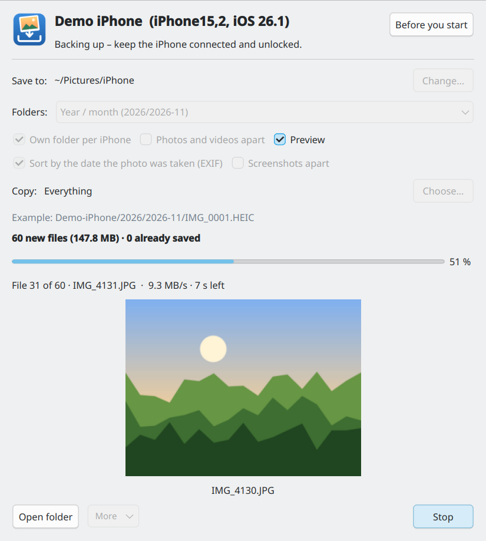
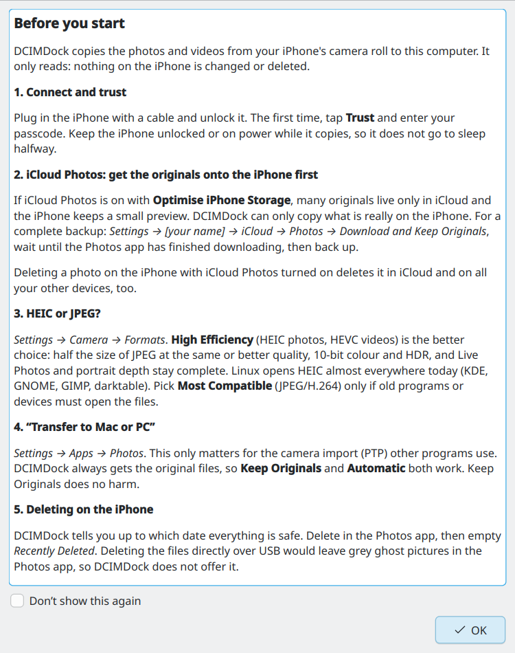

# DCIMDock

<p>
  
  <a href="https://github.com/TechnikWeber/DCIMDock/releases/latest"></a>
  <a href="https://github.com/TechnikWeber/DCIMDock/releases"></a>
  <a href="https://github.com/TechnikWeber/DCIMDock/actions/workflows/ci.yml"></a>
  
  
  <a href="LICENSE"></a>
</p>

<p>
  <a href="https://github.com/TechnikWeber/DCIMDock/releases/latest"><b>Download</b></a> &nbsp;·&nbsp;
  <a href="#download"><b>Install</b></a> &nbsp;·&nbsp;
  <a href="#before-you-start"><b>Before you start</b></a> &nbsp;·&nbsp;
  <a href="https://technikweber.github.io/2026/dcimdock-iphone-fotos-unter-linux/"><b>Blog post (German)</b></a> &nbsp;·&nbsp;
  <a href="https://github.com/TechnikWeber/DCIMDock/releases"><b>Releases</b></a>
</p>

Copy the photos and videos from your iPhone to your Linux computer over USB:
only what is new, never overwriting anything, with a progress bar and an
optional preview. Nothing on the iPhone is changed.



## Why

The usual way on Linux is a handful of commands: `idevicepair pair`,
`ifuse ~/iPhone`, `cp -a ~/iPhone/DCIM/. ~/Pictures/iPhone/`. That works
once. The second time it copies everything again, and after you delete
photos on the iPhone it may start again at `100APPLE/IMG_0001`. Then
`cp` silently overwrites your older backup with new photos of the same name.

## What it does

* Detects the iPhone and walks you through **Trust** and the passcode.
* Mounts it **read-only** (`ifuse -o ro`) in a private folder and unmounts
  it again afterwards.
* Copies **only new files**. An index per iPhone remembers what is already
  saved, so the second run takes seconds.
* **Never overwrites.** A name that is taken by a different file gets a
  suffix: `IMG_0001_1.HEIC`.
* Every file is written as `NAME.part`, synced to disk, size-checked and only
  then renamed. A pulled cable or a stop leaves no half files, and the next
  run continues where it stopped. A SHA-256 of each file goes into the index.
* Keeps what belongs together in one folder with the same suffix: Live Photo
  (`.HEIC` + `.MOV`), the edited version (`IMG_E…`) and the edit file (`.AAE`).
* Folders as you like: year/month (`2026/2026-11`), year/month/day, month,
  year, like on the iPhone (`100APPLE`) or all in one folder. Optionally a
  folder per iPhone and **photos and videos apart** (`Photos/…`, `Videos/…`;
  a Live Photo's video stays with its photo) and **screenshots apart**
  (recognised by the "Screenshot" mark iOS writes into them, not by guessing
  from `.PNG`). The window shows an example path.
* Sorts by the **date the photo was taken** (EXIF in JPEG, HEIC, PNG and DNG;
  the movie header in MOV and MP4), so an old picture you imported or saved
  lands in its own year, not in the month you saved it. Only new files are
  looked into, and it can be switched off to use the file date.
* **Several iPhones** at once: a list in the title picks the one to back up.
* Checks the free space before it starts.
* Progress bar with speed and time left. The **preview** of the photo just
  copied is decoded at reduced size in its own thread, at most about twice a
  second, so it does not slow the copy down. It can be switched off.
* At the end it tells you up to which date everything is safe, so you know
  what you can delete in the Photos app.
* A **Before you start** page on first launch covers iCloud Photos, HEIC vs
  JPEG and the iPhone settings (see below). Tick *Don't show this again* to
  hide it; the button in the window brings it back.
* **Copy everything again:** all files into a new folder
  (`Full copy 2026-11-11 21-30`), without comparing with earlier backups.
  The normal backup is not touched.
* **Check the backup:** reads every saved file again and compares it with
  the SHA-256 taken while copying. Worth doing before you delete photos on
  the iPhone. Works without the iPhone connected.
* **Troubleshooting** menu:
  * *Release stuck iPhone folders*: unmounts every ifuse mount, also
    hand-made ones like `~/iPhone`. A mount whose iPhone is gone
    (*Transport endpoint is not connected*) is released automatically on
    start.
  * *Pair again*: forgets the trust on this computer and asks the iPhone again.
  * *Restart the iPhone service* (`usbmuxd`, asks for your password).
  * *Diagnosis*: versions, device, pairing and mounts as text for a bug report.
* If the iPhone was mounted while locked (an empty pseudo folder without
  `DCIM`), DCIMDock unmounts it and asks you to unlock.
* Terminal mode for scripts:
  `dcimdock --cli [--dest DIR] [--layout ym|ymd|m|y|dcim|flat] [--split] [--screenshots] [--file-date] [--full] [--dry-run]`,
  and `dcimdock --verify --dest DIR` to check a backup.
* English or German, following the system language.

The speed limit is the iPhone's USB connection (roughly 20–35 MB/s on
Lightning), not DCIMDock: the copy engine itself handles over 300 MB/s with
about 25 MB of memory.

## Before you start

The same notes appear in the app on first launch:



* **iCloud Photos with "Optimize iPhone Storage"** keeps many originals only
  in iCloud. DCIMDock can only copy what is really on the iPhone. For a
  complete backup switch to *Download and Keep Originals* first and wait
  until the Photos app has downloaded everything.
* **HEIC or JPEG** (*Settings → Camera → Formats*): *High Efficiency* is the
  better choice: half the size, 10-bit color and HDR, complete Live Photos.
  Linux opens HEIC almost everywhere today.
* **"Transfer to Mac or PC"** (*Settings → Apps → Photos*) only matters for
  the camera import (PTP). DCIMDock always gets the original files.
* **Deleting:** DCIMDock does not delete anything on the iPhone. Deleting
  files directly over USB leaves grey ghost pictures in the Photos app.
  Delete in the Photos app and empty *Recently Deleted*. With iCloud Photos
  turned on, this deletes them in iCloud and on all your devices too.

## Download

DCIMDock needs `usbmuxd`, `ifuse` and the libimobiledevice tools from your
distribution. If they are missing, the window tells you the exact command:

| Distribution | Command |
|---|---|
| Fedora | `sudo dnf install ifuse libimobiledevice-utils usbmuxd` |
| Debian, Ubuntu, Mint | `sudo apt install ifuse libimobiledevice-utils usbmuxd` |
| Arch, EndeavourOS, Manjaro | `sudo pacman -S ifuse libimobiledevice usbmuxd` |
| openSUSE | `sudo zypper install ifuse imobiledevice-tools usbmuxd` |

Then, from the [latest release](https://github.com/TechnikWeber/DCIMDock/releases/latest):

| File | For |
|---|---|
| `dcimdock-*-x86_64.AppImage` | Any distribution: download, make executable, run. Or open it with [Gear Lever](https://flathub.org/apps/it.mijorus.gearlever), which also updates it. |
| `dcimdock-*.noarch.rpm` | Fedora: `sudo dnf install ./dcimdock-*.noarch.rpm`. Pulls in the tools above, uses the system Qt (native look, HEIC preview). |

Or from the source, for your user only:

```bash
git clone https://github.com/TechnikWeber/DCIMDock.git
cd DCIMDock
./install.sh      # menu entry + `dcimdock` command; ./uninstall.sh removes them
```

`install.sh` offers to install PySide6 and the tools above with your
package manager (dnf, apt, pacman or zypper).

## Good to know

* Copies the camera roll (`DCIM`): photos, videos, screenshots, Live Photos,
  edits. Albums, captions and the Photos library itself are not part of it.
* The **HEIC preview** needs Qt's HEIF plugin (`kf6-kimageformats` on
  Fedora/KDE, `kimageformats6` / `qt6-image-formats-plugins` elsewhere). The
  AppImage brings its own Qt without it and shows the file name instead. The
  copy itself is not affected.
* The backup folder holds a hidden `.dcimdock/` folder with the index.
  Deleting it is harmless: files that are already there are recognised by
  name, size and date and not copied again.
* No Flatpak package: a sandboxed app cannot reach `usbmuxd` and FUSE.
* Not affiliated with Apple. iPhone and iCloud are trademarks of Apple Inc.

## License

[MIT](LICENSE).
